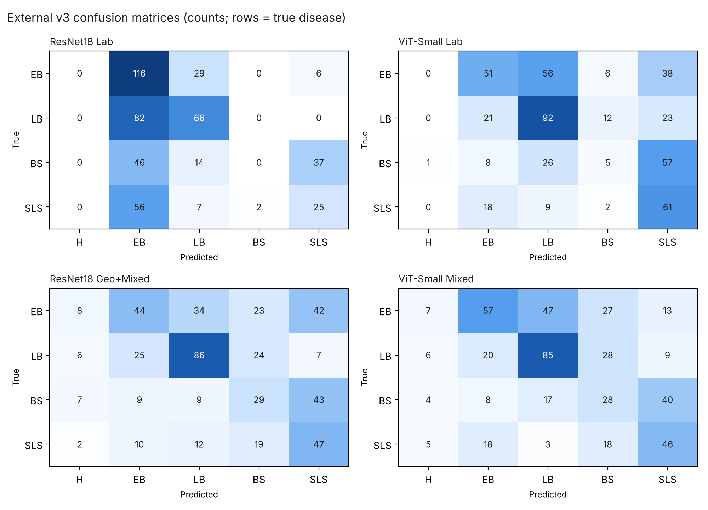
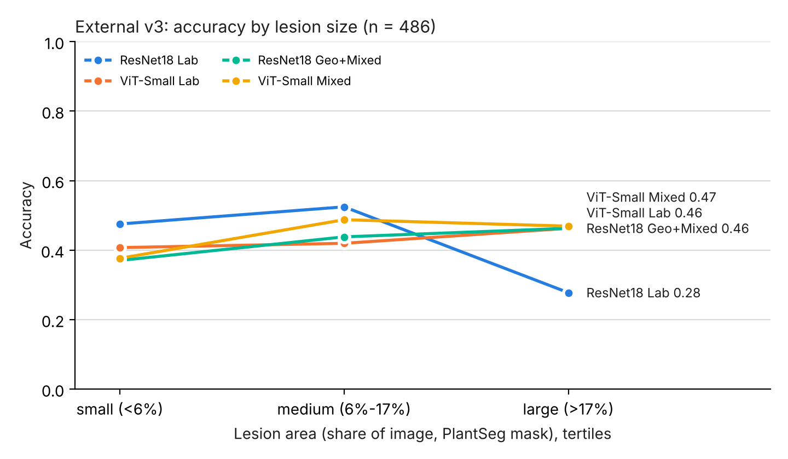

# Tomato Disease Classification: CNN and Vision Transformer under Domain Shift

## Abstract

This study investigates the generalization of deep learning models for five-class tomato leaf disease classification under laboratory-to-field domain shift. We compare ImageNet-pretrained **ResNet18** and **ViT-Small** using PlantVillage as the laboratory source domain and PlantDoc as the target domain.

The research examines data augmentation, supervised field adaptation, mixed-domain fine-tuning, external evaluation, class-specific errors, and image framing sensitivity. A final controlled experiment investigates whether laboratory rehearsal improves field performance when Field exposure and optimizer updates are matched.

**In short:** models trained on laboratory images lose most of their accuracy on field photographs; fine-tuning on field images changes which classes they get wrong more than how many; and adding laboratory images during that fine-tuning mainly protects laboratory accuracy.

Laboratory-trained models lose most of their accuracy on field photographs. Supervised field adaptation mainly teaches the models to recognise healthy field leaves. On **486 duplicate-screened PlantSeg disease images** evaluated once under a pre-registered protocol (External v3), every pre-registered project checkpoint scores 41–44% accuracy. The 95% intervals of the Lab-versus-adapted accuracy differences exclude gains larger than about 5 pp, while disease macro-F1 rises by 0.07–0.09 (intervals 0.03–0.13), so adaptation changes how errors are distributed more than how many there are. Under matched training exposure at the historical 8-epoch budget (before ResNet18 Field Dev had plateaued), adding laboratory images (Mixed fine-tuning) changes External v3 accuracy by +1.7 pp (95% CI −0.1 to +3.6; seed-level p = 0.12): no difference is detected. Its demonstrated benefit is retention of laboratory accuracy. At 24 epochs (exploratory, 3 seeds, reused test set), Mixed keeps a Lab Test macro-F1 advantage of +0.11 to +0.13 and is +2.4 pp higher on External v3 (95% CI +0.7 to +4.1; seed-level p = 0.06). Exploratory runs show that conclusions about CNN versus ViT depend on both the fine-tuning recipe and the training budget.

## Quick start

```bash
pip install -r requirements.txt            # requirements-lock.txt pins the exact versions (Linux x86_64; pulls CUDA wheels)
python scripts/download_checkpoints.py     # the 10 core checkpoints behind the headline results (add --group all for all 16), SHA-256 verified
pip install -r app/requirements.txt && streamlit run app/streamlit_app.py   # interactive demo
bash scripts/reproduce_round2.sh           # re-run the round-2 analyses and diff against committed results
```

First use downloads about 4 GB (PlantVillage, PlantDoc, PlantSeg and checkpoints). The demo's "example" mode loads the test sets from Hugging Face, so run it once before a live demonstration. Training the historical notebooks requires Colab GPU runtimes and is not part of this path.

## Where to find the evidence

| What to assess | Where it is |
| --- | --- |
| Computer-vision methods and why they were chosen | [Technical background](docs/technical_background.md) · [Methods at a glance](docs/methods.md) |
| Implementation and completeness | 15 notebooks; `src/` modules; round-2 scripts in [`scripts/`](scripts/); [demo app](app/streamlit_app.py); 54 automated tests, including [`tests/test_claims.py`](tests/test_claims.py), which recomputes the headline numbers in this README from the committed result files |
| Experimental design, controls, correctness | Matched-exposure, hash-sealed Notebook 15 ([RQ4](#4-controlled-field-only-vs-mixed-fine-tuning-rq4)); pre-registered External v3 ([protocol](data/external_v3_plantseg/protocol.json), committed before the run); duplicate screens of Field and Lab splits; LP-FT and 24-epoch budget checks of the architecture confound; Notebook 15 re-run at 24 epochs with sanity checks against the sealed checkpoints; occlusion with a same-area random-region control; AdaBN; Lab split duplicate audit |
| Results analysis and limitations | [Main Results](#main-results) by stratum, class, calibration, lesion size and label-boundary sensitivity; [Limitations](#limitations); [label-audit list](data/external_v3_plantseg/label_audit_candidates.csv) |
| Report, demo, reproducibility | This README; [Results Summary](docs/research_results_summary.md); [checkpoint registry](data/checkpoints.json) with SHA-256; pinned dataset revisions; [`requirements-lock.txt`](requirements-lock.txt); [`reproduce_round2.sh`](scripts/reproduce_round2.sh) |
| Every evaluation on a test partition, confirmatory or exploratory | [Evaluation ledger](docs/evaluation_ledger.md) |
| Exploratory analyses in full (moved out of this README) | [docs/exploratory_analyses.md](docs/exploratory_analyses.md) |
| Pre-registration order, checkable without reading the git log | [Provenance timeline](docs/provenance_timeline.md) (verified by `tests/test_provenance.py`) |

## Research Questions

The study addresses four connected research questions:

1. **RQ1 — Domain Shift:** How does classification performance change when laboratory-trained models are evaluated on field images?
2. **RQ2 — Domain Adaptation:** How do augmentation and fine-tuning affect field performance, source-domain retention, and class-specific errors?
3. **RQ3 — Image Framing:** How do leaf cropping and alternative inference views affect model predictions?
4. **RQ4 — Controlled Fine-tuning:** Does mixed-domain training consistently improve field performance under matched Field exposure and optimizer updates?

## Datasets and Evaluation Protocol

### Datasets

The primary datasets are:

- **[PlantVillage](https://huggingface.co/datasets/geraldmc/plantvillage-full):** Controlled laboratory images used for baseline training and evaluation.
- **[PlantDoc](https://huggingface.co/datasets/geraldmc/plantdoc-full):** Heterogeneous photographs used for field adaptation and evaluation.

Models classify five categories: **Healthy, Early Blight, Late Blight, Bacterial Spot, and Septoria Leaf Spot**.

| Partition                     |                Images | Purpose                                                    |
| ----------------------------- | --------------------: | ---------------------------------------------------------- |
| Lab Train / Validation / Test | 5,365 / 1,341 / 1,692 | Baseline training, selection, and evaluation               |
| Field Adapt Train / Dev       |              370 / 92 | Supervised adaptation and checkpoint selection             |
| Field Test                    |                    47 | Historical field evaluation                                |
| External Evaluation v1        |                    62 | Additional cross-source evaluation                         |
| External Evaluation v2        |                   103 | Extended evaluation collection with reviewed Healthy crops |
| External Evaluation v3        |                   486 | Locked, duplicate-screened PlantSeg disease images (no Healthy) |

Dataset splits and class mappings are recorded in [`data/splits/`](data/splits/). The verified PlantDoc preparation protocol excludes 14 training images due to near-test overlap or conflicting labels.

### External Evaluation v1 and v2

**External v1** contains 62 images: 16 self-collected Healthy images and 46 online-sourced disease images. It is used for fixed-model evaluation and class-specific error analysis in Notebooks 11–12.

**External v2** extends the collection to 103 images, preserving the 46 online disease images and including 57 self-collected Healthy evaluation images:

| Healthy subset                 | Images |
| ------------------------------ | -----: |
| Original photographs           |      8 |
| Previously approved leaf crops |      7 |
| Newly accepted leaf crops      |     42 |
| **Total Healthy**              | **57** |

The v2 dataset preserves human review decisions, image provenance, parent–crop relationships, and crop coordinates. Its construction and validation are documented in the [External v2 Dataset README](data/external_evaluation/tomato_field_eval_v2/README.md).

**Notebook 13 evaluates only the 57 Healthy images**, not all 103 v2 images. A separate exploratory analysis compares 23 parent photographs with their 49 associated leaf crops.

Because Healthy and disease images have different acquisition sources, v2 is not treated as an independent five-class field benchmark.

### External Evaluation v3 (PlantSeg, screened)

**External v3** is built from [PlantSeg](https://arxiv.org/abs/2409.04038) (Wei et al.), an in-the-wild disease-segmentation dataset with expert-reviewed lesion masks. Four of its tomato categories map onto the label set; Healthy is not represented, so v3 measures **disease discrimination only**. No model in this repository was trained or selected on PlantSeg.

Both PlantSeg and PlantDoc were collected from the web, so all 589 candidates were screened ([`scripts/build_external_v3_plantseg.py`](scripts/build_external_v3_plantseg.py)) against **all** PlantDoc rows and all PlantVillage tomato rows (20,738 references). Exact or pHash ≤ 10 matches were excluded (94 images: 77 at pHash ≤ 4 and 17 borderline at 5–10; 74 of them match rows used by this repository, including 4 Field Test rows — 2492, 2503, 2524, 2532 — and 6 Field Dev rows). The screen compares whole images, so crops, flips or re-posted variants can still pass; it is a lower bound on overlap. Within-PlantSeg near-duplicates were then collapsed (9 more).

| | Early Blight | Late Blight | Bacterial Spot | Septoria Leaf Spot | Total |
| --- | ---: | ---: | ---: | ---: | ---: |
| Included images | 151 | 148 | 97 | 90 | **486** |

The manifest, metrics, primary comparisons and Holm adjustment were committed in [`data/external_v3_plantseg/protocol.json`](data/external_v3_plantseg/protocol.json) before any model was run. The evaluation was then performed once (see the commit history). Only row indices and hashes are stored; PlantSeg is licensed CC BY-NC-ND 4.0.

Images shared between PlantSeg and the repository's PlantDoc rows carry two independent labels. **13 of 64 disagree** ([`label_audit_candidates.csv`](data/external_v3_plantseg/label_audit_candidates.csv)). Six of these are Bacterial Spot versus Septoria, and one is Field Test row 2524, already suspected of a label error, which PlantSeg labels Septoria.

## Models and Experimental Design

Two pretrained architectures are evaluated:

- **ResNet18:** A convolutional neural network using torchvision ImageNet-1K pretrained weights.
- **ViT-Small:** A Vision Transformer using timm `vit_small_patch16_224.augreg_in1k` pretrained weights.

Both use 224 × 224 model inputs with architecture-specific preprocessing.

The research follows four experimental stages:

| Stage                                 | Experiments                                                                                    | Notebooks |
| ------------------------------------- | ---------------------------------------------------------------------------------------------- | --------- |
| Laboratory baselines and domain shift | Data exploration, ResNet18/ViT training, baseline evaluation                                   | 01–04     |
| Adaptation and error analysis         | Augmentation, Field-only/Mixed fine-tuning, model comparison, Grad-CAM and external evaluation | 05–12     |
| Image framing sensitivity             | Healthy original–crop analysis and multi-crop inference                                        | 13–14     |
| Controlled comparison                 | Three-seed Field-only versus Mixed ResNet18 fine-tuning                                        | 15        |

The complete experimental implementations and saved outputs are available in [`notebooks/`](notebooks/).

## Main Results

All counts are correct images / images. Field partitions are small, and one image changes a class recall by 9–12.5 percentage points. Paired tests use exact McNemar with Holm adjustment across the reported family. Supporting tables are in [`data/results/supplementary_statistics/`](data/results/supplementary_statistics/).

### 1. Laboratory-to-Field Generalization (RQ1)

Five-class macro-F1 of the four fixed checkpoints. Field Dev selected the two adapted checkpoints (development scores); the 47-image Field Test was inspected from Notebook 04 onward.

| Model | Lab Test (1,692) | Field Dev (92) | Field Test (47) | External v1 (62) |
| --- | ---: | ---: | ---: | ---: |
| ResNet18 Lab baseline | 0.9744 | 0.2355 | 0.2802 (17/47) | 0.2406 (19/62) |
| ViT-Small Lab baseline | 0.9938 | 0.2677 | 0.3617 (21/47) | 0.4157 (27/62) |
| ResNet18 Geometric + Mixed | 0.9140 | 0.4459 | 0.3587 (19/47) | 0.4882 (33/62) |
| ViT-Small Mixed | 0.9886 | 0.3872 | 0.5103 (25/47) | 0.4808 (32/62) |

Laboratory accuracy does not transfer: on PlantDoc the lab-trained baselines fall from 0.97–0.99 to 0.24–0.36 macro-F1, and the adapted models reach at most 0.51. No model is best on every field partition. ResNet18 Geometric + Mixed leads on Field Dev, which selected it, but is below the ViT-Small Lab baseline on Field Test. A pHash audit of the Lab splits finds only 3 of 1,341 Validation and 2 of 1,692 Test images within distance 4 of a Lab Train image; removing them changes no model's Lab Test macro-F1 by more than 0.0001 ([`lab_split_duplicates/`](data/results/lab_split_duplicates/)). pHash does not detect different photographs of the same leaf, so this rules out near-copies, not same-leaf leakage. None of the eight paired comparisons between these models on Field Test and External v1 is significant after Holm adjustment over the ten-test family, which also includes the two disease-stratum tests (smallest adjusted p = 0.24).

**Exploratory references** ([details](docs/exploratory_analyses.md#1-frozen-foundation-model-reference-rq1), [architecture and budget](docs/exploratory_analyses.md#2-architecture-comparison-under-one-recipe-and-the-training-budget-rq1)). A frozen DINOv2 ViT-B/14 linear probe beats the fixed project checkpoints inside PlantDoc but by only 2–3 pp of accuracy on External v3, so gains measured inside PlantDoc overstate gains on other field data. Re-adapting both architectures with one recipe shows that the CNN-versus-ViT ranking depends on fine-tuning depth and training budget: at seed 42, ResNet18 Field Dev is still rising at epoch 23 of 24.

### 2. Adaptation and Class-Specific Errors (RQ2)

External v1 combines two sources that coincide with class: **16 self-collected Healthy** photographs and **46 online disease** images. Pooled accuracy therefore mixes "recognises healthy field leaves" with "discriminates diseases", so the two strata are reported separately.

| Model | Healthy, self-collected (16) | Disease, online (46) | Disease 4-class macro-F1 |
| --- | ---: | ---: | ---: |
| ResNet18 Lab baseline | 0/16 | 19/46 | 0.360 |
| ViT-Small Lab baseline | 5/16 | 22/46 | 0.445 |
| ResNet18 Geometric + Mixed | 12/16 | 21/46 | 0.437 |
| ViT-Small Mixed | 13/16 | 19/46 | 0.399 |

- Adaptation mainly fixes the baselines' failure to predict **Healthy** for field leaves. On online disease images, it gives no detectable gain: ResNet 19 → 21 (McNemar p = 0.83), ViT 22 → 19 (p = 0.58). The pooled ResNet improvement (19 → 33 of 62, unadjusted p = 0.024) is driven by the Healthy stratum and is not significant after Holm adjustment.
- Adaptation also shifts the ResNet decision threshold towards Healthy in general. On Lab Test, the adapted ResNet labels 63 diseased images as Healthy, against 2 for the baseline.
- **Early Blight is a failure for every model, in different ways.** The ResNet baseline's 11/13 Early Blight recall comes from predicting Early Blight for 39 of 62 external images in the canonical Notebook 11 run (precision 0.28; 43 of 62, precision 0.26, in the tracked upstream-loader predictions summarised in `external_v1_prediction_distribution.csv`) and for 55 of 92 Field Dev images. The adapted ResNet almost never predicts it (1/13).
- Bacterial Spot is confused with Septoria Leaf Spot across all models and partitions.

**Confirmation on External v3 (486 disease images, pre-registered, evaluated once).** On accuracy, the External v1 disease-stratum result holds at ten times the sample size; on class-balanced metrics, adaptation helps modestly.

| Model | Correct / 486 | Accuracy (Wilson 95% CI) | Disease macro-F1 | Predicted Early Blight | Predicted Healthy |
| --- | ---: | ---: | ---: | ---: | ---: |
| ResNet18 Lab baseline | 207 | 0.426 (0.383–0.470) | 0.333 | 300 | 0 |
| ViT-Small Lab baseline | 209 | 0.430 (0.387–0.474) | 0.375 | 98 | 1 |
| ResNet18 Geometric + Mixed | 206 | 0.424 (0.381–0.468) | 0.419 | 88 | 23 |
| ViT-Small Mixed | 216 | 0.444 (0.401–0.489) | 0.441 | 103 | 22 |

- Accuracy differences are small and their intervals exclude gains above about 5 pp: ResNet −0.2 pp (95% CI −5.3 to +5.1; McNemar p = 1.0), ViT +1.4 pp (−2.1 to +4.9; p = 0.49). The same holds with Healthy predictions excluded (disease-restricted argmax), for images ≥ 224 px, and on PlantSeg's own test split ([`comparisons.csv`](data/results/external_v3_plantseg/comparisons.csv)).
- Disease macro-F1, the pre-registered secondary metric, does improve: ResNet +0.086 (95% CI 0.039 to 0.133), ViT +0.065 (0.029 to 0.102). Balanced accuracy rises for ResNet (+0.050, 0.005 to 0.095) but not detectably for ViT (+0.016, −0.019 to +0.051). These intervals were added after the run ([`external_v3_secondary_metrics/`](data/results/external_v3_secondary_metrics/)).
- What adaptation changes is the **error profile**. The ResNet baseline assigns Early Blight to 300 of 486 images, the same 62% as on External v1 (39/62). Its Bacterial Spot recall is 0.00. Adapted models spread their predictions, which raises disease macro-F1 (0.333 → 0.419; 0.375 → 0.441) without raising accuracy.
| | |
| --- | --- |
|  |  |

- Adaptation also changes **calibration**. On field images the Lab baselines are confidently wrong: ResNet18 mean confidence is 0.90 at 0.43 accuracy (ECE 0.475), and ViT-Small 0.81 at 0.43 (ECE 0.384). The adapted models are far less over-confident (ECE 0.16–0.29). This is a practical benefit that accuracy alone hides. Accuracy by lesion size and confusion matrices are in [`data/results/external_v3_error_analysis/`](data/results/external_v3_error_analysis/).
- **Boundary sensitivity** (post-hoc, exploratory; [details](docs/exploratory_analyses.md#3-boundary-sensitivity-bacterial-spot-and-septoria-merged-rq2)). Merging Bacterial Spot and Septoria moves P1 from −0.2 to +4.5 pp (95% CI −0.8 to +9.9). This measures how much of the error lies on that boundary, not whether the labels are wrong.

**Normalization statistics (AdaBN, exploratory; [details](docs/exploratory_analyses.md#4-normalization-statistics-adabn-rq2)).** Re-estimating the Lab baseline's BatchNorm statistics on 370 unlabelled field images, with no weight changed, raises Field Dev macro-F1 from 0.235 to 0.391; accuracy changes are not significant. AdaBN applied after BN-frozen fine-tuning lowers every adapted checkpoint.

**Lesion reliance (exploratory, PlantSeg masks; [details](docs/exploratory_analyses.md#5-lesion-reliance-and-grad-cam-localization-with-plantseg-masks-rq2)).** Inpainting the expert-marked lesions lowers accuracy by 0.12–0.15 more than inpainting a same-area random region, so the models use lesion pixels. ResNet18 Grad-CAM localizes lesions above chance but no better than a centre-point prior, so its maps are not reliable evidence of where the models look.

### 3. Image Framing and Cropping Sensitivity (RQ3)

**Healthy recognition (Notebook 13, 57 self-collected Healthy images, 49 of them crops from 23 parent photographs in 21 scenes).** Correct: ResNet Lab 0/57, ViT Lab 15/57, ResNet Mixed 44/57, ViT Mixed 43/57. Comparing 23 parent photographs with their own crops, parent-balanced crop recall exceeds the original-photo recall for the adapted models (ResNet Mixed 10/23 originals vs 0.756 crop recall; ViT Mixed 14/23 vs 0.828). This is a Healthy-only population: it measures sensitivity, not specificity. The effective sample size is closer to 21–23 scenes than to 57 images.

**Automatic inference views (Notebook 14).** Center crops (0.70, 0.50) and five-crop averaging change predictions in both directions. Across 4 models × 3 alternative views × 2 datasets, the largest gain is ViT Mixed five-crop on External v1 (32 → 38/62, macro-F1 0.4808 → 0.5840). The largest loss is ResNet Mixed center-0.50 on Field Dev (macro-F1 0.4459 → 0.3603). These policies were compared after the outcomes were known. Every model input stays 224 × 224, so the study shows **sensitivity to framing**, not a resolution effect or a deployable policy.

### 4. Controlled Field-only vs. Mixed Fine-tuning (RQ4)

Notebook 15 compares Field-only (FO) and Mixed fine-tuning. It holds initialization (ResNet18 Lab baseline), Field exposure (all 370 images per epoch, identical augmented tensors), optimizer updates (192) and a shared checkpoint-selection epoch fixed. Mixed adds an equal number of Lab images per step. Seeds 42, 43 and 44 were declared before training, and checkpoints were hash-sealed before the Field Test was opened.

| Seed | Selected epoch | Field Dev macro-F1, FO / Mixed | Field Test macro-F1, FO / Mixed | Test images only FO / only Mixed correct |
| --- | ---: | ---: | ---: | ---: |
| 42 | 8 | 0.4388 / 0.4390 | 0.4338 / 0.3970 | 3 / 2 |
| 43 | 7 | 0.4361 / 0.4478 | 0.4214 / 0.3840 | 1 / 0 |
| 44 | 8 | 0.4147 / 0.4327 | 0.4349 / 0.4405 | 1 / 1 |

Mean Field Test macro-F1 is 0.4300 ± 0.0075 for Field-only and 0.4072 ± 0.0296 for Mixed. The seed-mean difference is −0.023, with a **paired bootstrap 95% CI of [−0.086, +0.024]**; for accuracy it is −0.014, CI [−0.064, +0.028]. On Field Dev at the selected epoch, Mixed is equal or higher in all three seeds. The two evaluation sets point in opposite directions, and the Test difference rests on a net two images.

**Lab retention.** Notebook 15 selected checkpoints on Field Dev only, so neither Lab partition was used by the controlled run. The six sealed checkpoints and their shared Lab baseline were evaluated on Lab Validation (1,341) and Lab Test (1,692) with [`scripts/evaluate_notebook15_lab_retention.py`](scripts/evaluate_notebook15_lab_retention.py) (inference only; every checkpoint SHA-256 checked against the seal first). The baseline reproduces its previously reported Lab Test result exactly (1,657/1,692, macro-F1 0.9744).

| Seed | Lab Val macro-F1, FO / Mixed | Lab Test macro-F1, FO / Mixed | Lab Test correct, FO / Mixed | Lab Test Δ macro-F1 (Mixed − FO) |
| --- | ---: | ---: | ---: | ---: |
| Lab baseline (shared initialization) | 0.9879 | 0.9744 | 1,657 | — |
| 42 | 0.8441 / 0.9733 | 0.8116 / 0.9553 | 1,490 / 1,634 | +0.144 |
| 43 | 0.8341 / 0.9706 | 0.8092 / 0.9449 | 1,482 / 1,622 | +0.136 |
| 44 | 0.8533 / 0.9780 | 0.8199 / 0.9603 | 1,499 / 1,641 | +0.140 |

Mean Lab Test macro-F1 is 0.8136 ± 0.0056 for Field-only and 0.9535 ± 0.0079 for Mixed (seed-mean difference +0.140). On Lab Validation it is 0.8438 ± 0.0096 vs 0.9740 ± 0.0038 (+0.130). Relative to the shared initialization, Field-only loses 0.161 Lab Test macro-F1 and Mixed loses 0.021. The difference has the same sign and similar size in every seed, and is more than ten times the seed-to-seed SD. The three seeds are evaluated on the same images, so they show training-run stability, not independent samples of laboratory data. Lab Validation also selected the baseline checkpoint, so its baseline value is optimistic, and Lab Test is the cleaner comparison. Images come from `geraldmc/plantvillage-full` at revision `f808f27` (the default branch at evaluation time). Per-checkpoint results, summaries and the protocol record are in [`data/results/notebook15_lab_retention/`](data/results/notebook15_lab_retention/).

**External v3 (pre-registered comparison P3).** On the 486 independent images, Mixed scores 211.0/486 and Field-only 202.7/486, averaged over the three seeds (accuracy 0.434 vs 0.417; difference +1.7 pp, paired bootstrap 95% CI [−0.1, +3.6]). The sign-flip permutation test gives p = 0.075, and the Holm-adjusted p is 0.23. Disease macro-F1 is 0.420 vs 0.405 (+0.014, 95% CI −0.003 to +0.032) and balanced accuracy +0.010 (−0.008 to +0.028; [`external_v3_secondary_metrics/`](data/results/external_v3_secondary_metrics/)). Mixed is higher in accuracy in all three seeds (+2.9, +0.6, +1.6 pp); with seeds as the unit, a one-sample t-test gives p = 0.12. The image-level tests above condition on these three training runs. The historical Field Test pointed the other way (accuracy −1.4 pp, macro-F1 −0.023). Both intervals include zero: the External v3 interval runs from −0.1 to +3.6 pp, so rehearsal is unlikely to cost more than 0.1 pp or to gain more than 3.6 pp. Both arms were compared at an 8-epoch budget where ResNet18 Field Dev had not plateaued (see the budget ablation in RQ1), so the comparison describes under-trained models.

**At a 24-epoch budget** (exploratory, 3 seeds, reused test set; [details](docs/exploratory_analyses.md#6-field-only-vs-mixed-at-a-24-epoch-budget-rq4)). Both arms were re-run for 24 epochs and reproduce the sealed Notebook 15 Lab Test values within 0.001 at the original epoch. Rehearsal keeps its retention benefit (+0.11 to +0.13 Lab Test macro-F1 in every seed, seed-level p = 0.001), and External v3 shows a small advantage of +2.4 pp (95% CI +0.7 to +4.1; seed-level p = 0.06). Training longer helps both arms more than rehearsal does.

**Weight interpolation** (exploratory; [details](docs/exploratory_analyses.md#7-weight-interpolation-as-an-alternative-to-rehearsal-rq4)). Interpolating between the Lab baseline and Field-only weights cannot reach Mixed's retention–field operating point on macro-F1 (0.17 lower Field Dev at equal Lab retention), but it is slightly higher on External v3 accuracy (0.447 vs 0.434), so the comparison is metric-dependent.
**Conclusion:** under matched exposure at the 8-epoch budget, laboratory rehearsal produces **no detectable difference in field performance** for this ResNet18 recipe (Field Test macro-F1 −0.023, 95% CI [−0.086, +0.024]; this does not establish equivalence, and a difference of a few points in either direction cannot be excluded), but it **largely prevents the loss of laboratory performance** (Lab Test macro-F1 −0.021 with Mixed vs −0.161 with Field-only). Both findings agree with the matched-initialization historical pair (Notebook 06 A1 vs Notebook 08 R1). There, Mixed did not improve Field Dev but retained Lab Validation much better (0.8185 → 0.9556). Notebook 15 now reproduces that retention effect with initialization, Field exposure and optimizer updates controlled. The earlier apparent Mixed advantage on field data came from comparing a geometric-augmentation initialization and selecting the best of six configurations on the same 92 Dev images. At 24 epochs (exploratory, above), the retention benefit persists and External v3 shows a small advantage for Mixed (+2.4 pp, 95% CI +0.7 to +4.1; seed-level p = 0.06).

## Discussion and Research Contributions

1. **Laboratory accuracy does not transfer.** The lab-trained baselines score 0.97–0.99 macro-F1 in the lab and 0.24–0.36 on PlantDoc. PlantVillage has documented capture bias (Noyan, 2022), which is a plausible contributor, though this study does not isolate it.
2. **Supervised field adaptation fixes the coarsest error and redistributes the rest.** Adapted models learn to call field leaves Healthy. On online disease images their accuracy is not detectably higher than the lab baselines' (intervals exclude gains above about 5 pp on External v3), but their errors are spread more evenly across classes (disease macro-F1 +0.07 to +0.09), and Early Blight / Bacterial Spot remain unsolved. Aggregate gains must be read by stratum, class and metric.
3. **Predictions are sensitive to framing**, both under human-reviewed crops and under automatic inference views. The direction depends on model and dataset.
4. **Lab rehearsal's robust benefit is retention.** A field advantage is not established: at 24 epochs (exploratory, 3 seeds, reused test set) External v3 favours Mixed with seed-level p = 0.06. With exposure matched at the 8-epoch budget, no field-performance difference between Mixed and Field-only fine-tuning was detected; equivalence was not tested, and on External v3 Mixed is higher in all three seeds by a non-significant 0.6–2.9 pp. At 24 epochs, Mixed is +2.4 pp higher on External v3 (95% CI +0.7 to +4.1; seed-level p = 0.06), while training longer raises both arms by 4.6–5.3 pp. On macro-F1, rehearsal reaches a retention–field operating point that post-hoc weight interpolation does not; on External v3 accuracy the two are similar.
5. **Models rely on lesions, but Grad-CAM does not show where.** Inpainting expert-marked lesions lowers accuracy by 0.12–0.15 more than inpainting a same-area random region (378 images), so lesion pixels matter. Grad-CAM localizes lesions above chance (0.58–0.66 vs 0.46) but no better than a centre-point prior (0.74), and adaptation does not change this: these ResNet18 Grad-CAM maps are not reliable evidence of where the models look; other attribution methods were not tested.
6. **Evaluation hygiene.** Duplicate-aware splits, hash-sealed checkpoints before test access, byte-level provenance of every reported prediction, a pre-registered one-shot external evaluation, and cross-dataset duplicate screening. Of 589 candidate images from one public "in-the-wild" dataset, 94 were excluded as exact or near duplicates of public training data (77 at pHash ≤ 4, 17 borderline at 5–10), 74 of them rows used in this repository.

### Related work and positioning

The laboratory-to-field gap itself is well established. Mohanty et al. (2016) reported about 31% accuracy for PlantVillage-trained models on online field images. Recent benchmarks report the same collapse from PlantVillage to PlantDoc (disease F1 12.9% in the MLD benchmark, Nalwanga et al., 2026), and greater robustness of vision-language models than CNNs under lab-to-field shift (AgriPath, Mooraj et al., 2026). RQ1 therefore replicates a known result rather than establishing it. What this study adds is:
- a **matched-exposure, hash-sealed comparison** of Field-only and Mixed fine-tuning, measured on both field performance and laboratory retention, together with a weight-interpolation alternative (Wortsman et al., 2022; Ilharco et al., 2022);
- **stratum-level analysis** showing that apparent field gains come from Healthy recognition;
- **external evaluation with duplicate screening and pre-registration**.

Label noise of the kind found here matters because small test-set error rates can reorder models (Northcutt et al., 2021).

Further interpretation: [Results Summary](docs/research_results_summary.md) · settings for every run: [Methods](docs/methods.md).

## Reproducibility

Clone the repository and install the dependencies:

```bash
git clone https://github.com/thutrang147/plant-disease-diagnosis.git
cd plant-disease-diagnosis

python3 -m venv .venv
source .venv/bin/activate
pip install -r requirements.txt
```

Run the available automated tests and repository audit:

```bash
python -m unittest discover -s tests -v
python scripts/audit_repository.py
python -m src.supplementary_analysis --output data/results/supplementary_statistics_rerun
```

These checks use saved research evidence and do not require model retraining.

**Checkpoints and inference results.** All 16 checkpoints are public on Google Drive. [`scripts/download_checkpoints.py`](scripts/download_checkpoints.py) fetches them into the paths documented in [`docs/workflow.md`](docs/workflow.md) and rejects any file whose SHA-256 differs from [`data/checkpoints.json`](data/checkpoints.json). Of those hashes:
- 11 are confirmed against earlier records (the Notebook 09 protocol, the Notebook 15 seal, and the source hash stored in the R2 checkpoint);
- 5 were first recorded on 2026-11-27.

PlantVillage is pinned to revision `f808f27` in `src/dataset.py`, PlantDoc to `v0.1.0`, and PlantSeg to `2fff5d6`. [`scripts/reproduce_round2.sh`](scripts/reproduce_round2.sh) downloads the checkpoints, runs the tests, re-runs the round-2 inference analyses into `reproduction/` and compares every CSV with the committed results. Add `--all` to also run the DINOv2 probe and the exploratory training runs. [`requirements-lock.txt`](requirements-lock.txt) records the exact package versions used.

**Demo.** `streamlit run app/streamlit_app.py` shows the prediction, class probabilities and ResNet18 Grad-CAM for an uploaded photo or a test-set example, and compares all available models on the same image.

The repository contains 15 canonical notebooks, evaluation modules, dataset manifests, selected prediction exports, and supporting documentation. Retraining the historical notebooks additionally requires Colab GPU runtimes and the original Drive layout.

See [Workflow and Artifact Provenance](docs/workflow.md) for setup and reproduction details.

## Limitations

- **The independent test covers diseases only.** External v3 (486 images) is locked, pre-registered and duplicate-screened, but it has several limits:
  - It is web-collected, has no Healthy images (so no Healthy specificity) and relies on unaudited PlantSeg labels.
  - Its whole-image hash screen cannot rule out cropped or re-posted variants.
  - Single-model Wilson intervals are about ±4.4 pp; paired comparisons are tighter (P3's interval spans about 3.6 pp), but an effect of 2–3 pp is still within the noise.
  - Only P1–P3 were confirmatory. External v3 was then reused for exploratory analyses (DINOv2, LP-FT, budget, interpolation, lesion and calibration analyses) without multiplicity control. The AdaBN and 24-epoch Notebook 15 analyses also used it ([ledger](docs/evaluation_ledger.md)).

  The 47-image Field Test was inspected early and reused, Field Dev selected checkpoints, and External v1 confounds source with class.
- **Label noise.** PlantDoc contains conflicting duplicates. One Field Test image (row 2524, Bacterial Spot) duplicates a training image labelled Septoria, is predicted Septoria in every controlled run, and is labelled Septoria by PlantSeg. Field Test row 2532 (Late Blight) is labelled Early Blight by PlantSeg, so two of the 47 Field Test labels are disputed — as many images as RQ4's net Field Test difference. 13 of 64 images shared with PlantSeg have conflicting labels, 6 of them Bacterial Spot ↔ Septoria, and await expert audit ([`label_audit_candidates.csv`](data/external_v3_plantseg/label_audit_candidates.csv)). On External v3, 14–27% of each model's errors are Bacterial Spot ↔ Septoria swaps, and merging the two classes moves P1 from −0.2 to +4.5 pp (CI −0.8 to +9.9), so the accuracy comparison is sensitive to that boundary (RQ2).
- **Confounded architecture comparison.** Pretraining, preprocessing, batch size, precision and the share of trainable parameters during adaptation (ResNet 75%, ViT 8%) all differ. Exploratory CPU runs show the ranking changes with fine-tuning depth and training budget; they are Field-only, unsealed and partly single-seed.
- **Low training budget.** The historical runs (including Notebook 15) selected their final or near-final epoch. A single-seed 24-epoch ablation indicates that ResNet18 Field Dev keeps rising through epoch 23 of 24 without a clear plateau, so the 8-epoch comparisons describe under-trained models. Notebook 15's two arms were re-run at 24 epochs with three seeds; these are CPU re-runs and unsealed. Notebooks 02–14 remain at 8 epochs.
- **Web-sourced "field" images.** PlantDoc photographs were collected from the web; several carry stock-photo watermarks. Field results describe web photographs, not images captured in the field by the project.
- **Metric choice and non-significance.** Accuracy depends on class priors: a model biased towards the largest class can match another model's accuracy with worse class balance, so accuracy and macro-F1 are reported together. No equivalence margin was pre-specified, so a non-significant difference is not evidence of equivalence.
- **Single seed** for Notebooks 02–14. Notebook 15 has three seeds on one ResNet18 recipe, all evaluated on the same 47 images.
- **Explanations are partly quantified.** PlantSeg masks quantify lesion reliance on External v3, but image edits create out-of-distribution inputs (both lesion removal and lesion-only views lower accuracy), Grad-CAM covers ResNet18 only, there are no lesion annotations for PlantDoc, and the cropping experiments do not isolate resolution.
- **Distribution.** Checkpoints, private evaluation images and some local outputs are not in the repository; see [Data Notice](DATA_NOTICE.md).

## References and Documentation

**Documentation**

- [Methods at a glance](docs/methods.md): data, every training recipe, evaluation and statistics
- [Research Results Summary](docs/research_results_summary.md)
- [Workflow and Artifact Provenance](docs/workflow.md)
- [Data Notice and licences](DATA_NOTICE.md)
- Process records (audits, reconciliation logs): [`docs/archive/`](docs/archive/)

**Key references**

- Hughes and Salathé (2015). _An Open Access Repository of Images on Plant Health to Enable the Development of Mobile Disease Diagnostics._ arXiv:1511.08060.
- Singh et al. (2020). _PlantDoc: A Dataset for Visual Plant Disease Detection._ CoDS-COMAD.
- Noyan (2022). _Uncovering Bias in the PlantVillage Dataset._ arXiv:2206.04374.
- Mohanty, Hughes and Salathé (2016). _Using Deep Learning for Image-Based Plant Disease Detection._ Frontiers in Plant Science.
- Wei et al. (2024). _PlantSeg: A Large-Scale In-the-wild Dataset for Plant Disease Segmentation._ arXiv:2409.04038.
- Nalwanga et al. (2026). _Multi-Crop Leaf Disease Recognition: A Unified Benchmark and Cross-Region Study._ arXiv:2610.04456.
- Mooraj et al. (2026). _AgriPath: A Systematic Exploration of Architectural Trade-offs for Crop Disease Classification._ arXiv:2603.13354.
- Kumar et al. (2022). _Fine-Tuning can Distort Pretrained Features and Underperform Out-of-Distribution._ ICLR.
- Wortsman et al. (2022). _Robust Fine-Tuning of Zero-Shot Models._ CVPR.
- Ilharco et al. (2022). _Patching Open-Vocabulary Models by Interpolating Weights._ NeurIPS.
- Oquab et al. (2024). _DINOv2: Learning Robust Visual Features without Supervision._ TMLR.
- Northcutt, Athalye and Mueller (2021). _Pervasive Label Errors in Test Sets Destabilize Machine Learning Benchmarks._ NeurIPS Datasets and Benchmarks.
- Zhang et al. (2018). _Top-Down Neural Attention by Excitation Backprop._ IJCV (pointing game).
- He et al. (2016). _Deep Residual Learning for Image Recognition._ CVPR.
- Dosovitskiy et al. (2021). _An Image Is Worth 16×16 Words: Transformers for Image Recognition at Scale._ ICLR.
- Steiner et al. (2022). _How to Train Your ViT? Data, Augmentation, and Regularization in Vision Transformers._ TMLR.
- Selvaraju et al. (2017). _Grad-CAM: Visual Explanations from Deep Networks via Gradient-Based Localization._ ICCV.
- McNemar (1947). _Note on the Sampling Error of the Difference between Correlated Proportions or Percentages._ Psychometrika.
- Holm (1979). _A Simple Sequentially Rejective Multiple Test Procedure._ Scandinavian Journal of Statistics.
